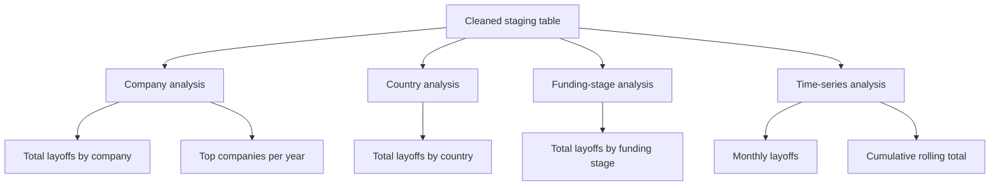

<div align="center">

# Global Layoffs Analysis

**A SQL-driven case study exploring workforce reductions across companies, countries, funding stages, and time.**

<a href="https://sohila-khaled-abbas.vercel.app/work/"><strong>Explore this project in my portfolio</strong></a>
&nbsp;·&nbsp;
<a href="https://github.com/Sohila-Khaled-Abbas">GitHub profile</a>

<br/>

[](https://github.com/Sohila-Khaled-Abbas/global-layoffs-analysis/stargazers)
[](https://github.com/Sohila-Khaled-Abbas/global-layoffs-analysis/forks)
[](https://github.com/Sohila-Khaled-Abbas/global-layoffs-analysis/commits/main)
[](LICENSE)


</div>

---

## Project overview

This project uses SQL to prepare and explore a global layoffs dataset. It follows the analytical workflow from staging and data-quality checks to exploratory queries that examine reported layoffs at company, country, funding-stage, and time-series levels.

The goal is to turn a raw table into a more consistent analytical dataset, then use aggregations and window functions to surface patterns that are useful for workforce and business analysis.

| Project area | What is included |
|---|---|
| **Data preparation** | Staging tables, duplicate detection, text standardization, date conversion, and missing-value review |
| **Exploratory analysis** | Company and country totals, funding-stage comparisons, monthly trends, and rolling totals |
| **Ranking analysis** | Top companies by reported layoffs within each year |
| **Data artifacts** | A cleaned CSV extract and a company/year ranking extract |

## Analytical workflow

The SQL scripts are organized as a preparation stage followed by exploratory analysis.

```mermaid
flowchart LR
    A["Source SQL table<br/>layoffs"] --> B["Create staging copy"]
    B --> C["Detect and remove duplicates"]
    C --> D["Standardize values and dates"]
    D --> E["Review incomplete records"]
    E --> F["Clean staging table<br/>layoffs_staging2"]
    F --> G["Exploratory SQL analysis"]
    G --> H["Trend, comparison and ranking outputs"]
    H --> I["CSV analysis extracts"]
```



### Analysis map

The exploratory queries investigate several complementary views of the same dataset.



## Data preparation

The cleaning script works with a MySQL table named `layoffs` and creates staging tables so that transformations can be performed without changing the initial source table.

The preparation workflow includes:

1. **Staging:** create a copy of the source table for cleaning.
2. **Duplicate review:** use `ROW_NUMBER()` with business-field partitions to identify duplicate records.
3. **Standardization:** trim company names and normalize selected location and country values.
4. **Date handling:** parse date strings with `STR_TO_DATE()` and convert the staging column to a date type.
5. **Missing-value review:** inspect incomplete records and remove rows where both layoff measures are missing.

> **Reproducibility note:** The original source file/database dump is not included. Load the source data into a MySQL table named `layoffs` before using the cleaning script. It also contains dataset-specific correction statements; review and validate the SQL in your own MySQL environment before running the script end-to-end. In particular, the missing-industry join/update block needs completion.

## Exploratory analysis

The EDA script uses aggregation, common table expressions (CTEs), and window functions to investigate:

- **Company impact:** total reported layoffs by company.
- **Geographic distribution:** reported layoffs by country.
- **Funding stage:** total layoffs grouped by funding stage.
- **Time trends:** monthly layoffs and cumulative rolling totals.
- **Annual ranking:** the top companies by layoffs for each year, using `DENSE_RANK()`.
- **Full workforce reductions:** records where the reported layoff percentage is 100%.

### Annual ranking snapshot

The committed `layoffs-EDA.csv` extract contains the leading company by reported layoffs in each year shown below.

| Year | Top-ranked company | Reported layoffs |
|---:|---|---:|
| 2020 | Uber | 15,050 |
| 2021 | Bytedance | 7,200 |
| 2022 | Meta | 22,000 |
| 2023 | Google | 24,000 |

*These figures come from the repository's annual company-ranking extract. They are company-level ranking values, not total layoffs across the entire year. The extract retains ties at the fifth rank, so some years contain more than five rows.*

## Repository structure

```text
global-layoffs-analysis/
├── data/
│   ├── layoffs-cleaned.csv
│   └── layoffs-EDA.csv
├── sql/
│   ├── Data Cleaning.sql
│   └── Exploratory Data Analysis.sql
├── LICENSE
└── README.md
```

| Asset | Description |
|---|---|
| [`data/layoffs-cleaned.csv`](data/layoffs-cleaned.csv) | Prepared dataset extract with company, location, industry, layoff measures, date, funding stage, country, and funds raised |
| [`data/layoffs-EDA.csv`](data/layoffs-EDA.csv) | Annual company ranking output with company, year, total layoffs, and rank |
| [`sql/Data Cleaning.sql`](sql/Data%20Cleaning.sql) | Staging, duplicate handling, standardization, date conversion, and missing-value checks |
| [`sql/Exploratory Data Analysis.sql`](sql/Exploratory%20Data%20Analysis.sql) | Aggregation, time-series analysis, rolling totals, and annual rankings |

## SQL techniques demonstrated

| Technique | How it is used |
|---|---|
| `CREATE TABLE ... LIKE` | Build staging tables based on the source structure |
| `ROW_NUMBER() OVER (...)` | Identify duplicate records |
| CTEs (`WITH`) | Structure multi-step analysis queries |
| `TRIM()` and string functions | Standardize text values |
| `STR_TO_DATE()` | Convert text dates into SQL dates |
| `GROUP BY` and aggregate functions | Compare layoffs across business dimensions |
| `SUM() OVER (...)` | Calculate cumulative monthly totals |
| `DENSE_RANK()` | Rank companies within each year |

## Explore the project

- **[View the SQL data-cleaning script](sql/Data%20Cleaning.sql)**
- **[View the exploratory analysis script](sql/Exploratory%20Data%20Analysis.sql)**
- **[Browse the prepared data](data/)**
- **[View the project in my portfolio](https://sohila-khaled-abbas.vercel.app/work/)**

## Scope and possible extensions

The current repository focuses on SQL-based data preparation and exploratory analysis. It does not currently include the original raw-data download, an automated refresh pipeline, or a Power BI/Tableau dashboard.

Potential next steps include adding a reproducible database setup, strengthening data-quality validation, and building an interactive dashboard on top of the prepared dataset.

---

## About

**Sohila Khaled Abbas**  
Data Analyst · BI Developer · Analytics Engineer

I build analytical solutions that connect data preparation, SQL, and business-focused insights.

[Portfolio](https://sohila-khaled-abbas.vercel.app/work/) · [GitHub](https://github.com/Sohila-Khaled-Abbas) · [LinkedIn](https://www.linkedin.com/in/sohilakabbas/)

---

**License:** This project is available under the [MIT License](LICENSE).
