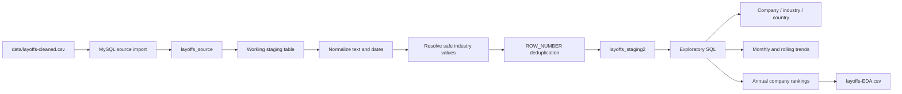

<div align="center">

# Global Layoffs Analysis

**A MySQL analytics case study exploring workforce reductions across companies, industries, countries, funding stages, and time.**

<a href="https://sohila-khaled-abbas.vercel.app/work/"><strong>Explore this project in my portfolio</strong></a>
&nbsp;·&nbsp;
<a href="https://github.com/Sohila-Khaled-Abbas">GitHub profile</a>

<br/>

[](https://github.com/Sohila-Khaled-Abbas/global-layoffs-analysis/stargazers)
[](https://github.com/Sohila-Khaled-Abbas/global-layoffs-analysis/forks)
[](https://github.com/Sohila-Khaled-Abbas/global-layoffs-analysis/commits/main)
[](LICENSE)


</div>

---

## Project overview

This project uses SQL to prepare and analyze a global layoffs dataset. It follows a reproducible workflow from importing the repository's CSV snapshot into MySQL, through duplicate handling and data standardization, to exploratory queries that examine company, country, industry, funding-stage, and time-series patterns.

The analysis demonstrates practical SQL techniques including staging tables, window functions, safe data standardization, common table expressions (CTEs), aggregations, and annual ranking.

## Dataset profile

The repository extract covers reported layoffs from **11 March 2020 to 2 March 2023**.

| Data-quality measure | Verified value |
|---|---:|
| Rows in committed CSV extract | **3,984** |
| Repeated business-key rows detected | **1,992** |
| Distinct records after deduplication | **1,992** |
| Date coverage | **2020-03-11 – 2023-03-02** |
| Source fields | 9 |

<text></text>

**Important data note:** the file is named `layoffs-cleaned.csv`, but the committed extract contains every business-key record twice. The import script treats it as the available source snapshot; the cleaning workflow detects and removes the repeated records before analysis. This is documented rather than hidden behind the filename.

The source fields are company, location, industry, total layoffs, layoff percentage, date, funding stage, country, and funds raised (millions).

## Analytical workflow



### Data preparation

The cleaning pipeline is designed to be rerun without changing the imported source table.

1. **Import:** load the committed CSV snapshot into a typed MySQL source table.
2. **Staging:** copy the source into a working table before transformations.
3. **Standardization:** trim text values, normalize empty strings to `NULL`, parse dates, and harmonize the two observed cryptocurrency industry labels.
4. **Industry inference:** fill an unknown industry only when the company's non-null records agree on exactly one industry. Conflicting or unresolved values are preserved for review.
5. **Deduplication:** use `ROW_NUMBER()` over company, location, industry, layoff count, layoff percentage, and date. Secondary fields provide a deterministic tie-break order.
6. **Analytical eligibility:** exclude a record only when both layoff measures are missing. A record with either measure available is retained.

The cleaning script does **not** assign blank industries to Crypto, use broad city-name wildcards, delete selected companies by name, or turn off SQL safe-update mode.

### Exploratory analysis

The EDA script covers:

- Total layoffs by company.
- Country, industry, and funding-stage comparisons.
- Records reporting a 100% layoff rate.
- Annual and monthly layoff trends.
- Monthly cumulative rolling totals using a window function.
- Average reported layoff percentage by company.
- Top five companies per year using `DENSE_RANK()`, preserving ties.

## Annual ranking snapshot

The committed `data/layoffs-EDA.csv` file contains annual company rankings. The leading company shown for each year is:

| Year | Top-ranked company | Reported layoffs |
|---:|---|---:|
| 2020 | Uber | 15,050 |
| 2021 | Bytedance | 7,200 |
| 2022 | Meta | 22,000 |
| 2023 | Google | 24,000 |

*These are the top company-level values from the ranking extract, not total layoffs for the whole year. The SQL uses `DENSE_RANK()`, so tied companies can cause more than five rows to appear for a year.*

## Repository structure

```text
global-layoffs-analysis/
├── data/
│   ├── layoffs-cleaned.csv
│   └── layoffs-EDA.csv
├── sql/
│   ├── 00_Load_Source_Data.sql
│   ├── Data Cleaning.sql
│   └── Exploratory Data Analysis.sql
├── LICENSE
└── README.md
```

| File | Purpose |
|---|---|
| [`sql/00_Load_Source_Data.sql`](sql/00_Load_Source_Data.sql) | Creates the MySQL source table and imports the supplied CSV |
| [`sql/Data Cleaning.sql`](sql/Data%20Cleaning.sql) | Builds staging tables, standardizes values, safely infers missing industry labels, and deduplicates |
| [`sql/Exploratory Data Analysis.sql`](sql/Exploratory%20Data%20Analysis.sql) | Aggregations, time-series analysis, rolling totals, and annual company rankings |
| [`data/layoffs-cleaned.csv`](data/layoffs-cleaned.csv) | The CSV snapshot used as the import source |
| [`data/layoffs-EDA.csv`](data/layoffs-EDA.csv) | Annual company-ranking output |
| [`LICENSE`](LICENSE) | MIT license |

## Run the project

**Requirements:** MySQL 8.0 or later, with the `LOCAL INFILE` capability enabled in the MySQL client and server.

1. Clone the repository:

   ```bash
   git clone https://github.com/Sohila-Khaled-Abbas/global-layoffs-analysis.git
   cd global-layoffs-analysis
   ```

2. Open `sql/00_Load_Source_Data.sql` and replace the placeholder path with the absolute path to your local `data/layoffs-cleaned.csv` file. Use forward slashes in the path on Windows.

3. Confirm `local_infile` is enabled. The import script begins with:

   ```sql
   SHOW VARIABLES LIKE 'local_infile';
   ```

   If `LOCAL INFILE` is disabled, enable the option for your MySQL client and server before running the import.

4. Execute the scripts in this order from MySQL Workbench or a MySQL client:

   | Order | Script | Result |
   |---:|---|---|
   | 1 | `00_Load_Source_Data.sql` | `layoffs_source` |
   | 2 | `Data Cleaning.sql` | `layoffs_staging2` |
   | 3 | `Exploratory Data Analysis.sql` | Analytical query results |

5. Review the data-quality checks at the end of the cleaning script. Then run the EDA queries against `layoffs_staging2`.

**Re-running:** the import script drops and recreates only `layoffs_source`. The cleaning script recreates its derived staging tables and leaves the source table untouched. Do not run the import step against a source table containing work you need to preserve.

## SQL techniques demonstrated

| Technique | Application |
|---|---|
| `CREATE TABLE ... LIKE` | Create a working copy of the imported source schema |
| `LOAD DATA LOCAL INFILE` | Load the provided CSV extract into MySQL |
| `NULLIF()`, `TRIM()`, `STR_TO_DATE()` | Normalize text, nulls, and date values |
| `ROW_NUMBER() OVER (...)` | Identify repeated business records |
| `GROUP BY` and `HAVING` | Build a company-to-industry lookup only where the mapping is unambiguous |
| CTEs (`WITH`) | Structure multi-stage analytical queries |
| `SUM() OVER (...)` | Calculate cumulative monthly totals |
| `AVG()` | Summarize reported layoff percentages without adding percentages together |
| `DENSE_RANK()` | Rank companies within each year while preserving ties |

## Scope and limitations

- The repository contains a CSV snapshot and SQL scripts; it does not include a live data ingestion service or automatic refresh pipeline.
- The CSV's filename is retained for compatibility, but the extract contains repeated business-key records that are removed by the cleaning process.
- The project is a SQL analytics case study. It does not currently include a Power BI or Tableau dashboard.
- Industry inference is deliberately conservative: ambiguous company-to-industry mappings remain unresolved instead of being assigned arbitrarily.

## Explore the project

- **[Data import script](sql/00_Load_Source_Data.sql)**
- **[Data cleaning script](sql/Data%20Cleaning.sql)**
- **[Exploratory analysis script](sql/Exploratory%20Data%20Analysis.sql)**
- **[Browse the datasets](data/)**
- **[View the project in my portfolio](https://sohila-khaled-abbas.vercel.app/work/)**

## About

**Sohila Khaled Abbas**  
Data Analyst · BI Developer · Analytics Engineer

I build analytical solutions that connect reliable data preparation, SQL, and business-focused insights.

[Portfolio](https://sohila-khaled-abbas.vercel.app/work/) · [GitHub](https://github.com/Sohila-Khaled-Abbas) · [LinkedIn](https://www.linkedin.com/in/sohilakabbas/)

---

**License:** This project is available under the [MIT License](LICENSE).
